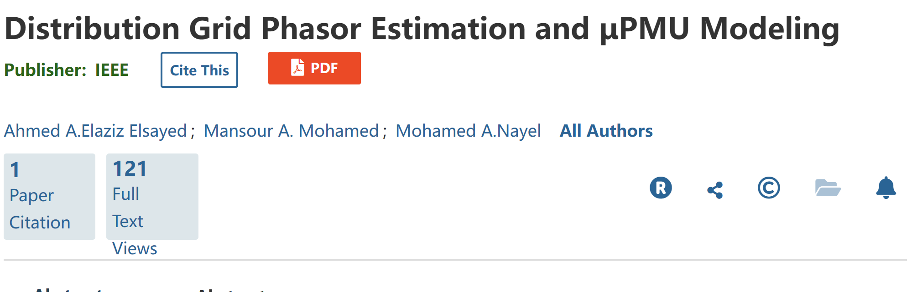

# Power Distribution Network Phasor Estimation and μPMU Modeling (Simulink)

μPMUs are a promising monitoring device that monitors and intelligently manages power distribution networks by providing synchronized phasor measurements of bus voltages and branch currents, as well as sequence components, frequency, and harmonic content. They employ high-precision designs to withstand the challenges of power distribution networks. Understanding the behavior and error sources of μPMUs under different operating conditions is crucial for meeting the required quality standards. This paper introduces a MATLAB/SIMULINK μPMU model that addresses issues such as analog filtering, GPS uncertainty, nominal external operational errors, and methods for eliminating these errors. The proposed model is tested using standard input waveforms with unit step frequency variations. Additionally, the model performance on unbalanced power distribution network feeders with random load changes is evaluated. The model demonstrates accurate estimates of phasor magnitude, angle, sequence components, frequency, and harmonic content.
Abstract:
μPMUs
are a promising monitoring device for monitoring and smarting the distribution grid by providing a synchronized phasor measurement of bus voltages and branch phasor currents besides sequence components, frequency, and harmonics content. They are designed with high accuracy level to withstand the distribution grid challenges. Understanding μ PMUs behavior and error sources under different operation conditions are essential to address the desired quality standard. This paper presents a MATLAB/SIMULINK μPMU  
model, which addressed the analog filter, GPS uncertainty, and off-nominal operation errors and the elimination methods of these errors. The proposed model is tested using a standard input wave with unit step frequency change. Moreover, the model performance is evaluated for unbalanced distribution grid feeders with random load change. The model showed accurate estimation of phasors magnitude, angles, sequence components, frequency, and harmonics content.  

## Images

<!-- PAYMENT_BLOCK -->

## Get this dataset

- Payment link (Stripe): [Buy now](https://buy.stripe.com/3cs8yP7sY87d0vu9AB)
- Payment QR code: 

<!-- /PAYMENT_BLOCK -->
